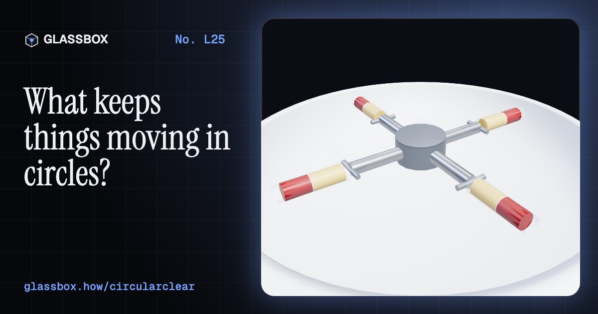
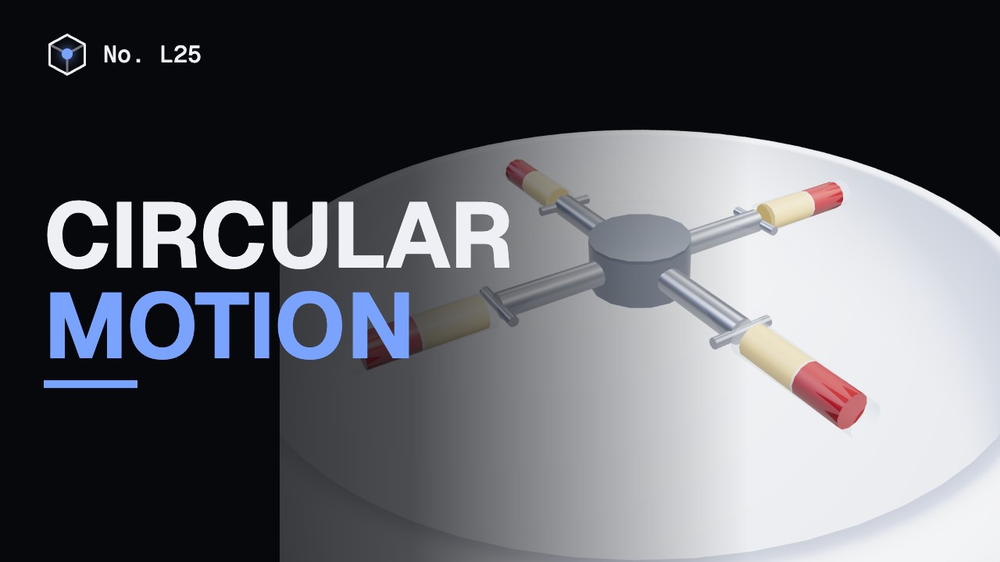
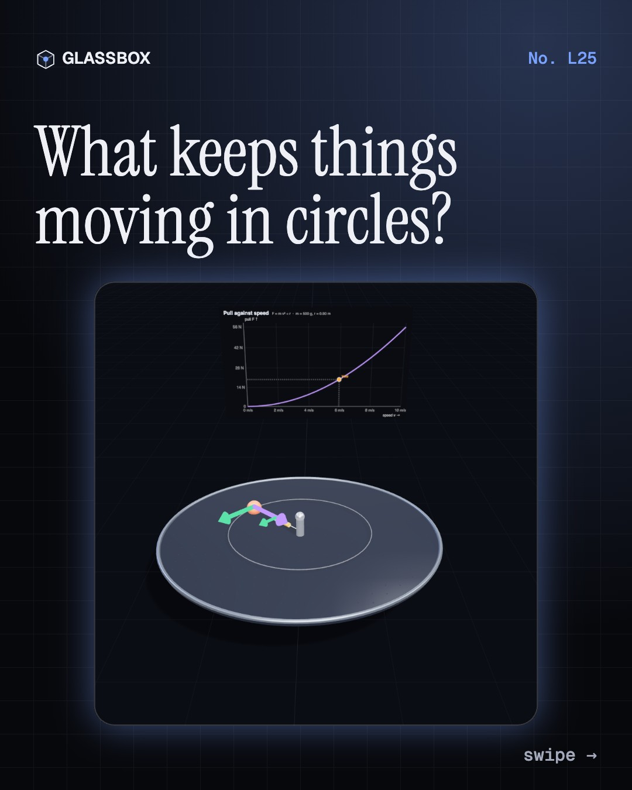
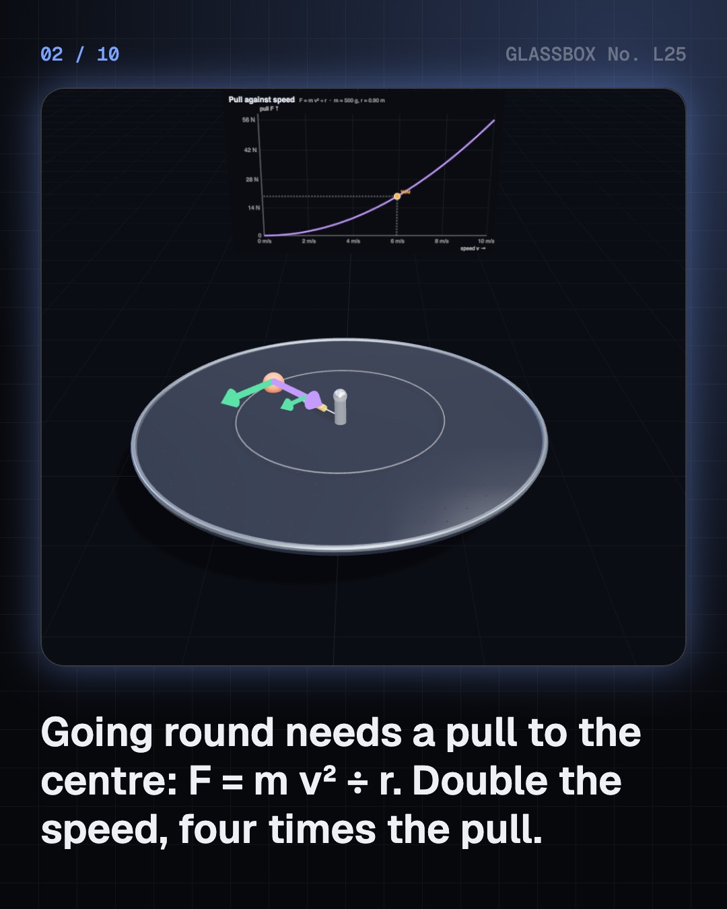
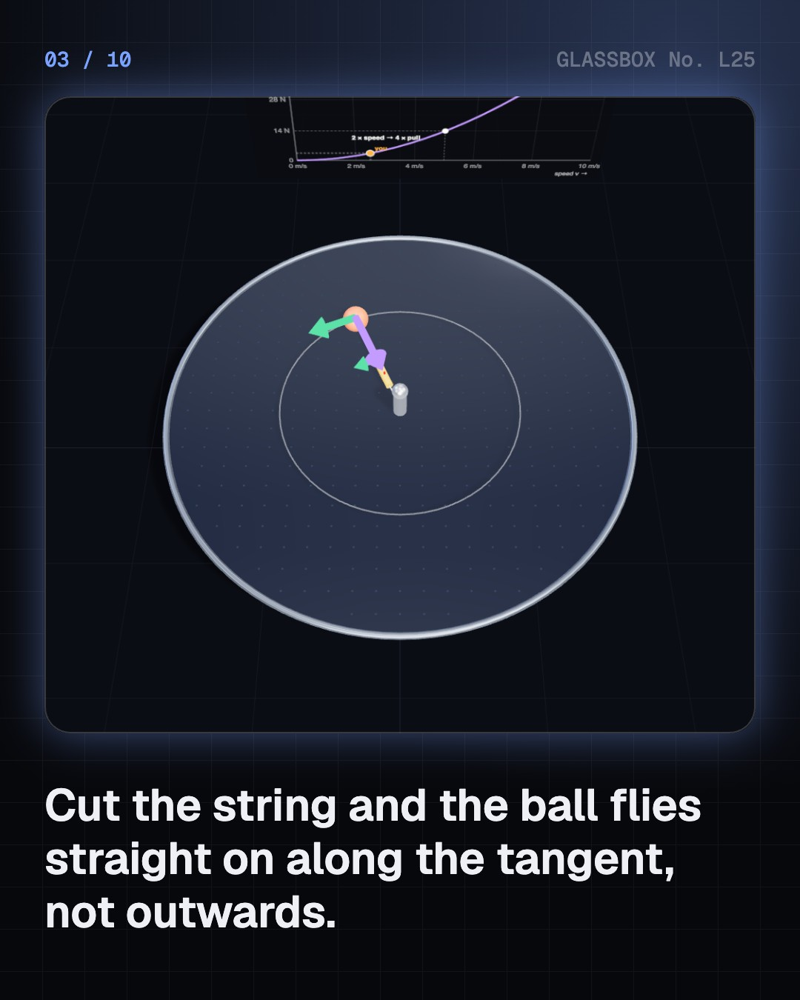
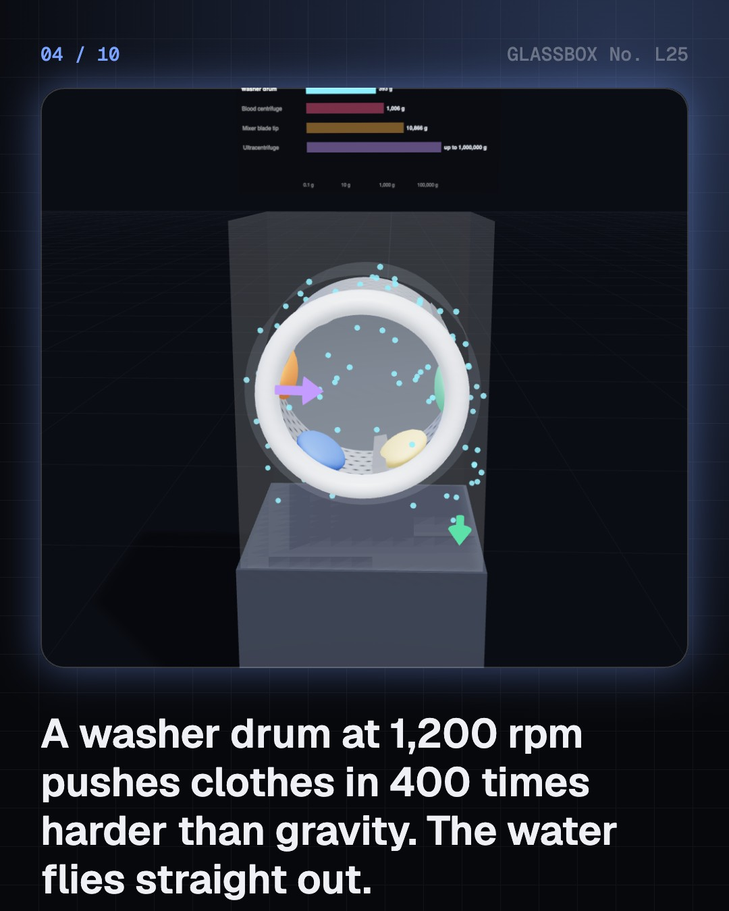

<!-- glassbox:start -->
<!-- Generated from glassbox.json by the Glassbox hub (npm run readme -- circularclear). Edit glassbox.json, not this block. -->
<p align="center"><a href="https://glassbox-production-fd52.up.railway.app/e/circularclear/"></a></p>

<h1 align="center">Circular motion</h1>

<p align="center"><b>What keeps things moving in circles?</b><br>Whirl a ball on a string, then cut it: the ball flies off straight, not outwards. Spin-dry clothes at 400 g, feel 10,000 g at a mixer's blade tip, take a bend on a wet road, loop the loop, ride India's wall of death, and bust the myths of centrifugal force and the backwards-draining sink.</p>

<p align="center"><a href="https://glassbox-production-fd52.up.railway.app/circularclear/"><b>▶ Play with it</b></a> &nbsp;·&nbsp; <a href="https://glassbox-production-fd52.up.railway.app/e/circularclear/">Read the 60-second explainer</a> &nbsp;·&nbsp; <a href="https://glassbox-production-fd52.up.railway.app/circularclear/glassbox/reel.mp4">Watch the 40-second video</a></p>

<p align="center">
  <a href="https://glassbox-production-fd52.up.railway.app/e/circularclear/"></a>
  <a href="https://glassbox-production-fd52.up.railway.app/e/circularclear/"></a>
  <a href="LICENSE"></a>
  <a href="LICENSE-CONTENT.md"></a>
  <a href="#privacy"></a>
</p>

## In 60 seconds

1. **Turning needs a pull.** Going round a circle means your direction changes all the time, so you are accelerating towards the centre: a = v² ÷ r. Something must supply F = m v² ÷ r. Double the speed and you need four times the pull. Cut the string and the ball carries straight on along the tangent.
2. **Spinning machines.** Every point on a spinning part moves at v = ω r and needs ω² r. A washer drum at 1,200 rpm reaches 400 g, so water leaves through the holes; a mixer's blade tips pass 10,000 g; a blood centrifuge at 1,000 g separates plasma from red cells in minutes.
3. **On the road.** On a flat bend only tyre friction turns you, so the top speed is √(μ g r) whatever the mass: 71 km/h on a dry 50 m bend. Banked tracks let the road's push help, with no friction needed at √(g r tan θ). Bikes lean until tan θ = v² ÷ (g r).
4. **Rides and space.** A loop needs v ≥ √(g r) at the top, so the cart must enter at √(5 g r). Giant wheels make you lighter at the top. On the wall of death the wall's push lets friction hold riders up. A ring 224 m in radius spinning at 2 rpm would make 1 g.
5. **Myths and limits.** Nothing flings you outwards: centrifugal force is inertia seen from a turning frame. The Coriolis effect steers cyclones but is a millionth of g in a sink, so it doesn't choose the drain's direction. Near light speed the formula needs Einstein's correction.

## Words worth knowing

| Term | Meaning |
|---|---|
| **Centripetal force** | The inward pull or push that keeps something moving in a circle: F = m v² ÷ r. |
| **Centripetal acceleration** | The acceleration towards the centre of a circle, a = v² ÷ r = ω² r, in m/s². |
| **Angular speed (ω)** | How fast something turns, in radians per second; 60 rpm is 6.28 rad/s. Points further out move faster: v = ω r. |
| **g-force** | An acceleration measured in multiples of gravity, a ÷ 9.81. A washer drum at 1,200 rpm reaches about 400 g. |
| **Banking** | Tilting a road or track inwards so the road's own push helps turn you. |
| **Apparent weight** | The push you feel from a seat or floor. It changes in a curve: lighter at the top of a giant wheel, heavier at the bottom. |
| **Centrifugal force** | The outward force you seem to feel in a turning frame. It is inertia, not a push from anything. |
| **Coriolis effect** | In a turning frame, moving things seem to curve sideways. On Earth it steers winds and cyclones. |

## A short history

**From a sling and a pendulum clock to cream separators, the wall of death and a spinning tether in orbit.**

- **1659** · Huygens finds the rule (Christiaan Huygens, The Hague, Netherlands)
- **1673** · Centrifugal force goes public (Christiaan Huygens, Paris, France)
- **1684** · Newton names centripetal force (Isaac Newton, Cambridge, England)
- **1835** · The Coriolis effect (Gaspard-Gustave de Coriolis, Paris, France)
- **1878** · De Laval's continuous cream separator (Gustaf de Laval, Stockholm, Sweden)
- **1893** · The first Ferris wheel (George Washington Gale Ferris Jr., Chicago, USA)
- **1924** · The ultracentrifuge (Theodor Svedberg, Uppsala, Sweden)
- **1966** · Artificial gravity in orbit (Pete Conrad and Richard Gordon, Gemini 11, Earth orbit)

The full story, with 20 moments, charts, people and 30 sources: [glassbox.how/e/circularclear/history](https://glassbox-production-fd52.up.railway.app/e/circularclear/history/). The data lives in [`history.json`](history.json).

## Video and slides

Made with the Glassbox studio from this box's storyboard (`window.glassbox.director`). Free to reuse under CC BY 4.0.

<a href="https://glassbox-production-fd52.up.railway.app/circularclear/glassbox/video.mp4"></a>

<p><a href="glassbox/slide-1.jpg"></a> <a href="glassbox/slide-2.jpg"></a> <a href="glassbox/slide-3.jpg"></a> <a href="glassbox/slide-4.jpg"></a></p>

| File | What | Size |
|---|---|---|
| [`glassbox/reel.mp4`](https://glassbox-production-fd52.up.railway.app/circularclear/glassbox/reel.mp4) | Reel / Short, with captions and soundtrack | 1080×1920 |
| [`glassbox/video.mp4`](https://glassbox-production-fd52.up.railway.app/circularclear/glassbox/video.mp4) | YouTube video, with captions and soundtrack | 1920×1080 |
| `glassbox/slide-1…10.jpg` | Instagram carousel | 1080×1350 |
| `glassbox/thumb.jpg` | YouTube thumbnail | 1280×720 |
| `glassbox/cover.jpg` | Share card and repo social preview | 1200×630 |
| [`glassbox/history-reel.mp4`](https://glassbox-production-fd52.up.railway.app/circularclear/glassbox/history-reel.mp4) | “History in 10 moments” Reel / Short | 1080×1920 |
| `glassbox/history-slide-*.jpg` | History carousel | 1080×1350 |
| `glassbox/post.json` | Post copy and schedule used by the publish kit | |

## Privacy

This box has no accounts and no ads, and it ships its own fonts and libraries. When you run it yourself it sends nothing anywhere. On glassbox.how, the site's `/bar.js` also loads Glassbox's analytics: **Google Analytics** to count visits (it asks first in the EU, UK and Switzerland, and stays off when your browser sends Global Privacy Control or Do Not Track) and **ClickTrust** to detect bots.

It remembers a few things **in your own browser only**, and never sends them anywhere:

| Browser storage key | What it holds |
|---|---|
| `circularclear.v1` | Which chapters you have opened, your best quiz scores, and sound on or off. |

Exactly what each one sees is at [glassbox.how/privacy](https://glassbox-production-fd52.up.railway.app/privacy/).

## Licences

- **Code:** [MIT](LICENSE). Use it, change it, ship it.
- **Explanations, text, images and videos** (`glassbox.json`, `glassbox/`): [CC BY 4.0](LICENSE-CONTENT.md). Credit “Glassbox, glassbox.how/e/circularclear”.
- **Third-party parts** keep their own licences: [three.js](https://threejs.org) (MIT), [Geist, Instrument Serif](https://openfontlicense.org) (SIL OFL 1.1).
- The Glassbox name and logo aren't covered by either licence. See the [terms](https://glassbox-production-fd52.up.railway.app/terms/).

Found a mistake? [Open an issue](https://github.com/bdeeps/circularclear/issues). Corrections happen in public.
<!-- glassbox:end -->

## Run it

It's plain HTML, CSS and JavaScript. No build step and no dependencies. Run locally, it contacts no other website.

```bash
python3 -m http.server 8000
```

Three.js and the fonts ship in `vendor/` and `fonts/`, so it also works offline.

Then open http://localhost:8000.

## How it's built

| File | What |
|---|---|
| `index.html`, `css/app.css` | The page and its styles |
| `js/app.js`, `js/stage.js`, `js/ui.js`, `js/kit.js` | The shared Glassbox 3D engine: chapters, 3D stage, controls, quiz, video director |
| `js/circular.js` | Circular-motion formulas (F = m v² ÷ r, g-force, √(μ g r), lean angle), chart boards, force arrows, and the car, rider and person models |
| `js/chapters/*.js` | One file per chapter: the 3D model, controls, text, key terms, quiz and video scenes |
| `glassbox.json` | Title, question, explainer beats, key terms, browser storage and credits shown on glassbox.how |
| `reel` in each chapter | The storyboard the Glassbox studio records into short videos |
| `glassbox/` | The published video, slides, thumbnail and post copy |
| `fonts/`, `vendor/three/` | Self-hosted Geist and Instrument Serif (SIL OFL 1.1) and three.js (MIT) |
